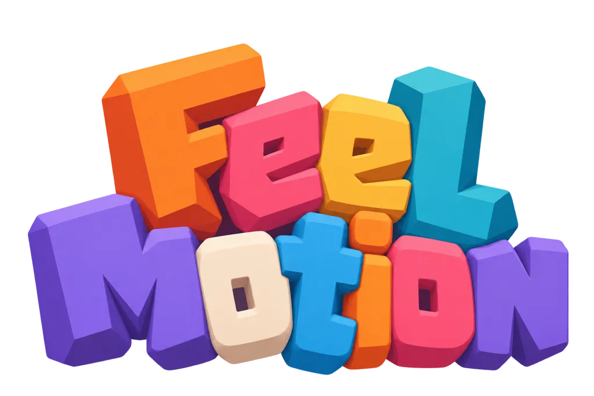

# ⚡ FeelMotion



**FeelMotion** is an Inspector-first animation and game juice library for Unity that gives you the best of both worlds:

> **FeelMotion = LitMotion (faster than DOTween) + FEEL (but lighter and cleaner design)**
> 

Completely **free and open-source**! Bring your game to life with buttery-smooth tweens and polished feedback without the bloat.

---

## ✨ Why You'll Love It

* **Blazing Fast**: Powered by [LitMotion](https://github.com/annulusgames/LitMotion)'s struct-based handles for maximum performance and zero per-frame update allocations.


* **Inspector-First**: Author powerful animation sequences and side effects directly in the Unity Inspector using a clean, modern UIElements interface.


* **Modular & Lightweight**: Only compile what you need! Features a clean assembly split with isolated optional modules for UI, Audio, Physics, TextMeshPro, Camera, and Rendering.


* **Flexible Playback**: Run your actions **Sequential** or **Parallel**, complete with global duration and intensity multipliers, robust state handling, and instant previews.


* **Easily Extensible**: Create custom actions with minimal boilerplate using familiar property wrappers or custom binds that auto-populate into the Inspector.


---

## 📦 Installation

### Requirements

FeelMotion requires the following packages to be installed manually:

- [LitMotion](https://github.com/annulusgames/LitMotion)
- [UniTask](https://github.com/Cysharp/UniTask)

### Install FeelMotion

In Unity, open **Window ▸ Package Manager ▸ + ▸ Install package from git URL…** and enter:

```
https://github.com/cholushkin/FeelMotion.git
```

FeelMotion is ready to use once all dependencies are installed.

---

## 🚀 Quick Start

1. Attach a **`FeelMotionPlayer`** component to any GameObject.
2. Click **"Add Action..."** in the Inspector to choose your tween or side effect.
3. Hit **Play** and enjoy the juice! ✨

---

Free, open-source, and crafted for smooth gameplay experiences.
